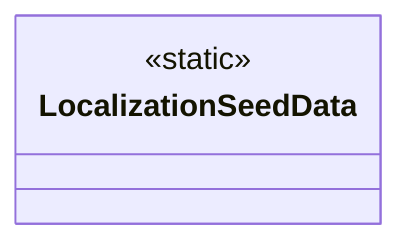

# LocalizationSeedData

> Initial ES/EN values for every localization key. Spanish values match the texts authored in scenes/prefabs (so "Bind Selected" can match them). Only used to seed missing entries: edit translations in the tables.

**Módulo:** [[Modulo Editor|Editor]] · **Namespace:** `AlienFarms.Editor` · **Archivo:** `Assets/Scripts/Editor/LocalizationSeedData.cs`

## Diagrama

## Usa
[[LocalizationKeys]], [[LocalizationSeedEntry]]

## Usado por
[[LocalizationSetupMenu]]
