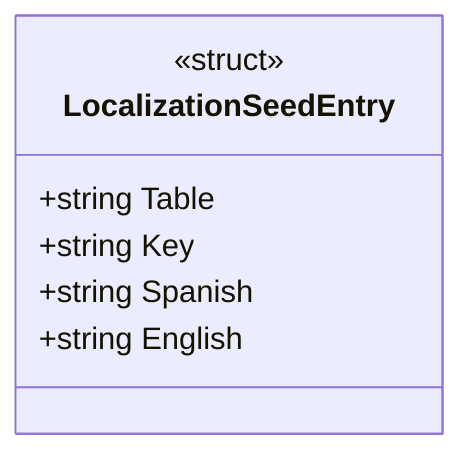

# LocalizationSeedEntry

> One string table entry seeded by `LocalizationSetupMenu`.

**Módulo:** [[Modulo Editor|Editor]] · **Namespace:** `AlienFarms.Editor` · **Archivo:** `Assets/Scripts/Editor/LocalizationSeedEntry.cs`

## Diagrama

## Usado por
[[LocalizationSeedData]], [[LocalizationSetupMenu]]
