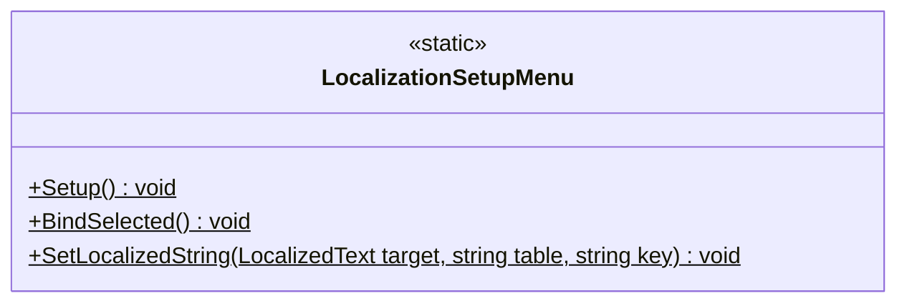

# LocalizationSetupMenu

> Idempotent localization setup: creates whatever is missing (settings, es/en locales, UI/HowToPlay tables and their entries) and enforces the startup configuration. Never overwrites existing translations. Also offers a helper that adds `LocalizedText` to selected TMP texts by matching their Spanish text.

**Módulo:** [[Modulo Editor|Editor]] · **Namespace:** `AlienFarms.Editor` · **Archivo:** `Assets/Scripts/Editor/LocalizationSetupMenu.cs`

## Diagrama

## Usa
[[LocalizationKeys]], [[LocalizationSeedData]], [[LocalizationSeedEntry]], [[LocalizedText]], [[ViewDrivenTextCollector]]
