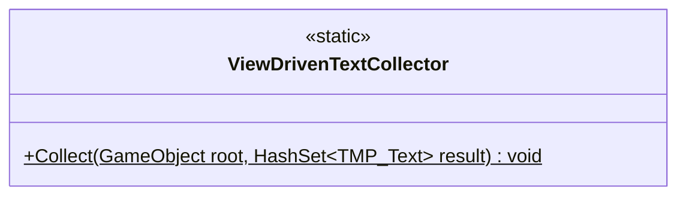

# ViewDrivenTextCollector

> Finds TMP texts referenced by AlienFarms components (views write them from code, so they must never get a static `LocalizedText`). LocalizedText itself is ignored.

**Módulo:** [[Modulo Editor|Editor]] · **Namespace:** `AlienFarms.Editor` · **Archivo:** `Assets/Scripts/Editor/ViewDrivenTextCollector.cs`

## Diagrama

## Usa
[[LocalizedText]]

## Usado por
[[LocalizationSetupMenu]]
