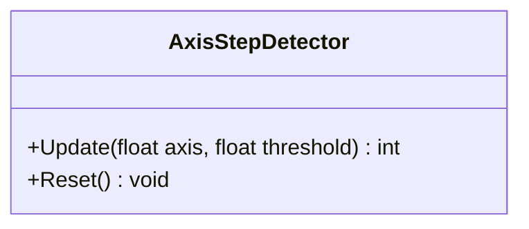

# AxisStepDetector

> Plain C# edge detector that turns a continuous axis (stick, dpad) into discrete steps: -1 or +1 once when the axis crosses the threshold, 0 otherwise. Holding does not repeat; returning inside the threshold re-arms it.

**Módulo:** [[Modulo Input|Input]] · **Namespace:** `AlienFarms.Input` · **Archivo:** `Assets/Scripts/Input/AxisStepDetector.cs`

## Diagrama

## Usado por
[[PlayerMenuInput]]
