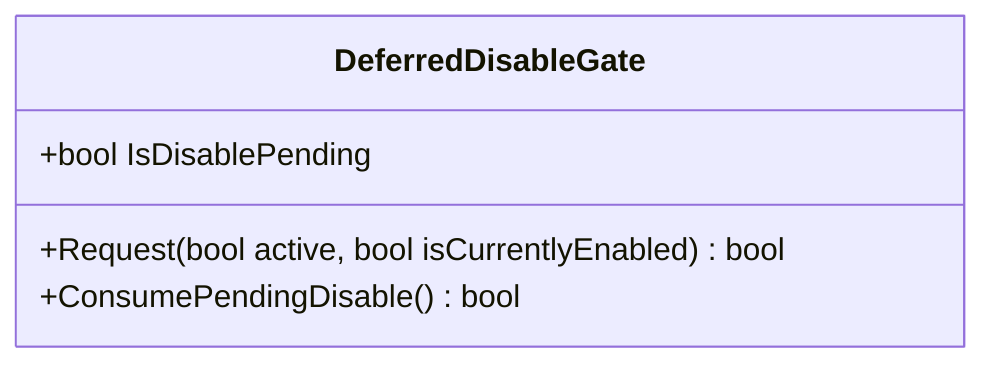

# DeferredDisableGate

> Plain C# helper for a component that may be enabled at once but must only be disabled later (e.g. an EventSystem that cannot be disabled from inside its own Update). A later enable request cancels a pending disable.

**Módulo:** [[Modulo Input|Input]] · **Namespace:** `AlienFarms.Input` · **Archivo:** `Assets/Scripts/Input/DeferredDisableGate.cs`

## Diagrama

## Usado por
[[PlayerMenuInput]]
