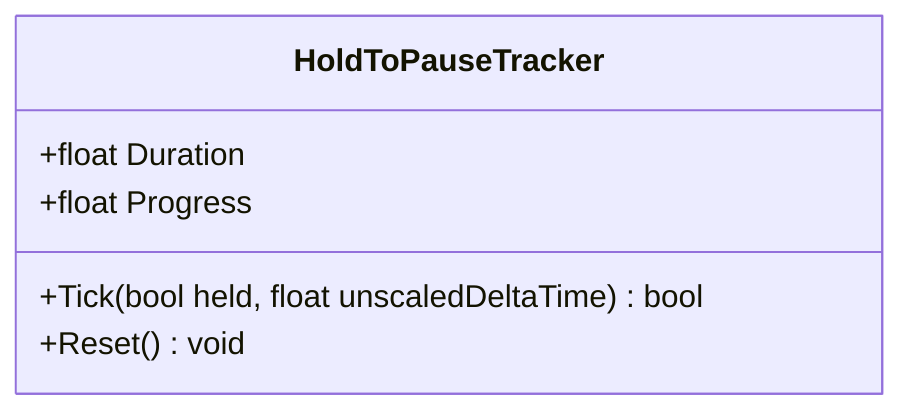

# HoldToPauseTracker

> Plain C# hold-to-confirm timer: accumulates while a button is held and reports completion once. After completing, the button must be released before it can complete again; releasing early resets the progress.

**Módulo:** [[Modulo Input|Input]] · **Namespace:** `AlienFarms.Input` · **Archivo:** `Assets/Scripts/Input/HoldToPauseTracker.cs`

## Diagrama

## Usado por
[[PlayerPauseInput]]
