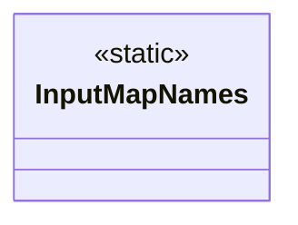

# InputMapNames

> Action map names defined in AlienFarmsControls.inputactions.

**Módulo:** [[Modulo Input|Input]] · **Namespace:** `AlienFarms.Input` · **Archivo:** `Assets/Scripts/Input/InputMapNames.cs`

## Diagrama

## Usado por
[[PlayerMenuInput]]
