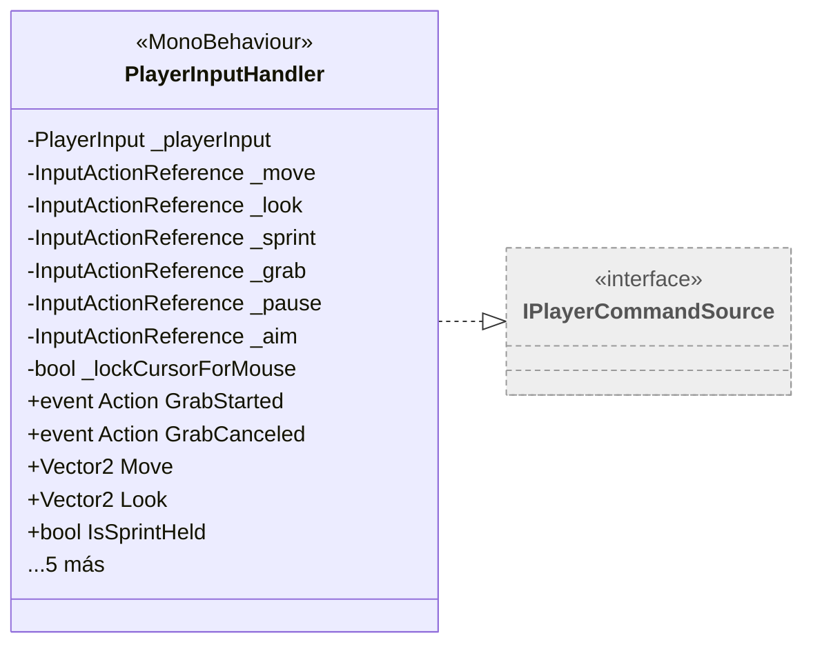

# PlayerInputHandler

> Reads gameplay input from this player's own `PlayerInput`. The serialized `InputActionReference`s only identify actions; the live actions are resolved by id on `PlayerInput.actions`, which is a per-player clone under PlayerInputManager. It is the local `IPlayerCommandSource` of the player's gameplay components.

**Módulo:** [[Modulo Input|Input]] · **Namespace:** `AlienFarms.Input` · **Archivo:** `Assets/Scripts/Input/PlayerInputHandler.cs`

## Hereda / implementa
`MonoBehaviour`, [[IPlayerCommandSource]]

## Diagrama

## Usa
[[IPlayerCommandSource]], [[InputSchemeNames]]

## Usado por
[[Mode]], [[NetworkCarry]], [[NetworkPlayerInput]], [[PlayerMenuInput]], [[PlayerPauseInput]]
