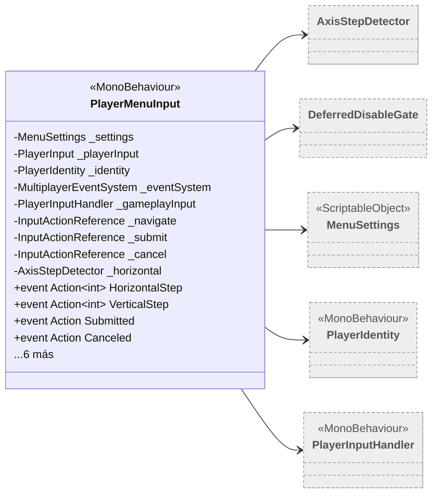

# PlayerMenuInput

> Per-player menu navigation. `EnterMenu` switches this player's `PlayerInput` to the UI map and scopes its own `MultiplayerEventSystem` to a menu root; `ExitMenu` restores gameplay. `SetBlocked` deactivates all of this player's input (used for the player who does not own a menu). Also exposes discrete navigation steps and Submit/Cancel for menus driven by code instead of Selectables.

**Módulo:** [[Modulo Input|Input]] · **Namespace:** `AlienFarms.Input` · **Archivo:** `Assets/Scripts/Input/PlayerMenuInput.cs`

## Hereda / implementa
`MonoBehaviour`

## Diagrama

## Usa
[[AxisStepDetector]], [[DeferredDisableGate]], [[GameEvents]], [[InputMapNames]], [[MenuSettings]], [[PlayerId]], [[PlayerIdentity]], [[PlayerInputHandler]]

## Usado por
[[MenuFlowController]], [[MenuLobby]], [[PlayerMenuRouter]], [[PlayerRig]]

## Eventos que publica
[[Eventos GameEvents#OnMenuCancelPressed|OnMenuCancelPressed]], [[Eventos GameEvents#OnPlayerDeviceLost|OnPlayerDeviceLost]], [[Eventos GameEvents#OnPlayerDeviceRegained|OnPlayerDeviceRegained]]
