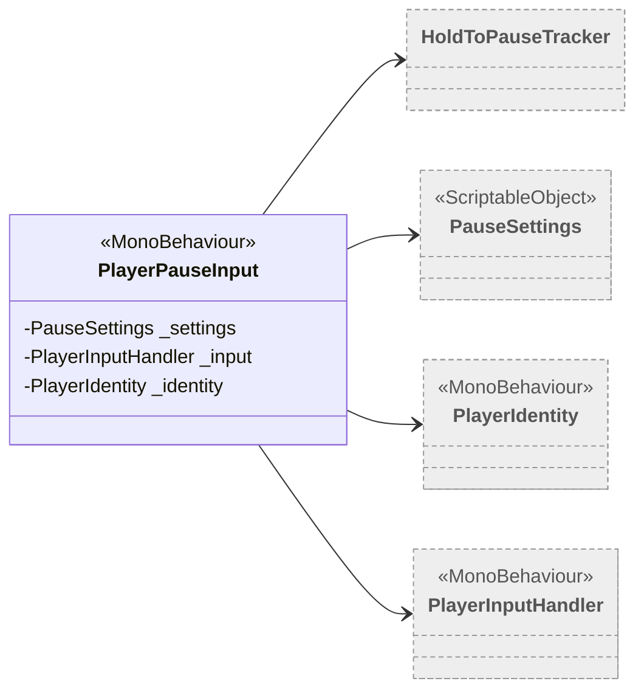

# PlayerPauseInput

> Hold-to-pause for one player: holding this player's Pause button for `PauseSettings.HoldDuration` (unscaled) raises `GameEvents.OnPauseRequested`. Progress is published only while it changes.

**Módulo:** [[Modulo Input|Input]] · **Namespace:** `AlienFarms.Input` · **Archivo:** `Assets/Scripts/Input/PlayerPauseInput.cs`

## Hereda / implementa
`MonoBehaviour`

## Diagrama

## Usa
[[GameEvents]], [[HoldToPauseTracker]], [[PauseSettings]], [[PlayerIdentity]], [[PlayerInputHandler]]

## Eventos que publica
[[Eventos GameEvents#OnPauseHoldProgress|OnPauseHoldProgress]], [[Eventos GameEvents#OnPauseRequested|OnPauseRequested]]
