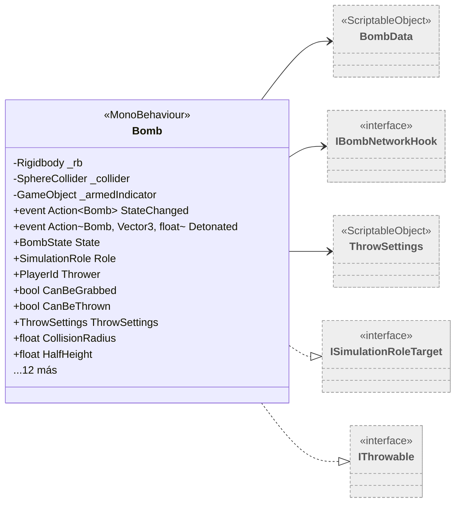

# Bomb

> Pooled stun bomb. Inert while lying around or dropped (Idle): anyone can carry it, it never explodes. Thrown, it is Armed and explodes on its first contact that is not its thrower (or after a timeout), stunning every other player in the blast radius and scaring nearby free animals. It never touches capture or score. Does not share a base with Animal on purpose (its armed/inert behavior is different); the hold snap and the release order (dynamic before writing position/velocity) are duplicated consciously from it. As a `SimulationRole.Replica` it never arms, detonates or raises GameEvents: its body is kinematic and its state comes from `ApplyReplicatedState`.

**Módulo:** [[Modulo Items|Items]] · **Namespace:** `AlienFarms.Items` · **Archivo:** `Assets/Scripts/Items/Bomb.cs`

## Hereda / implementa
`MonoBehaviour`, [[IThrowable]], [[ISimulationRoleTarget]]

## Diagrama

## Usa
[[Animal]], [[BombBlastRules]], [[BombData]], [[BombState]], [[DropReason]], [[GameEvents]], [[IBombNetworkHook]], [[IScareable]], [[ISimulationRoleTarget]], [[IStunnable]], [[IThrowable]], [[LayerNames]], [[PlayerId]], [[PlayerIdentity]], [[SimulationRole]], [[ThrowSettings]]

## Usado por
[[Animal]], [[AnimalSpawner]], [[BombData]], [[BombSfxPlayer]], [[BombSpawner]], [[GameEvents]], [[IBombNetworkHook]], [[LayerNames]], [[NetworkBomb]], [[NetworkBombPoolHandler]], [[NetworkSpawnRegistry]], [[PlayerGrabber]]

## Eventos que publica
[[Eventos GameEvents#OnBombArmed|OnBombArmed]], [[Eventos GameEvents#OnBombDespawned|OnBombDespawned]], [[Eventos GameEvents#OnBombDetonated|OnBombDetonated]], [[Eventos GameEvents#OnBombGrabbed|OnBombGrabbed]], [[Eventos GameEvents#OnBombSpawned|OnBombSpawned]]
