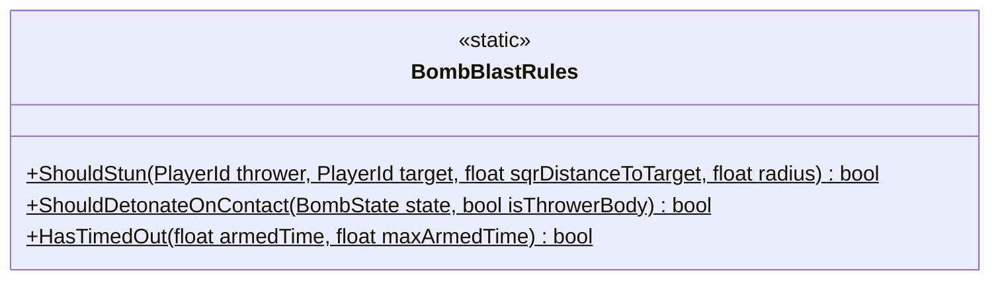

# BombBlastRules

> Pure rules of the stun bomb (who gets stunned, when it explodes). No Unity state, fully testable.

**Módulo:** [[Modulo Items|Items]] · **Namespace:** `AlienFarms.Items` · **Archivo:** `Assets/Scripts/Items/BombBlastRules.cs`

## Diagrama

## Usa
[[BombState]], [[PlayerId]]

## Usado por
[[Bomb]]
