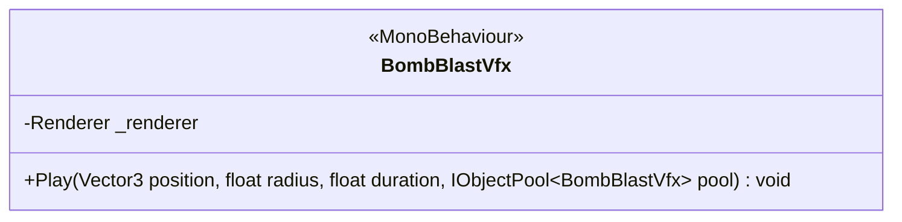

# BombBlastVfx

> Pooled blast effect: a sphere that expands to the blast size and fades out, then returns to its pool.

**Módulo:** [[Modulo Items|Items]] · **Namespace:** `AlienFarms.Items` · **Archivo:** `Assets/Scripts/Items/BombBlastVfx.cs`

## Hereda / implementa
`MonoBehaviour`

## Diagrama

## Usado por
[[BombBlastVfxPlayer]], [[BombData]]
