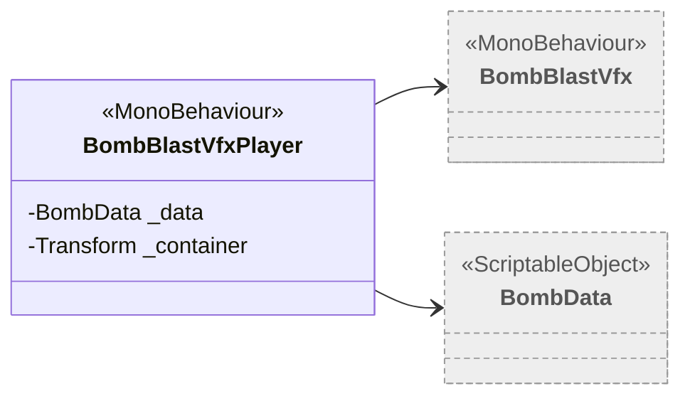

# BombBlastVfxPlayer

> Plays a pooled `BombBlastVfx` on every `GameEvents.OnBombDetonated`.

**Módulo:** [[Modulo Items|Items]] · **Namespace:** `AlienFarms.Items` · **Archivo:** `Assets/Scripts/Items/BombBlastVfxPlayer.cs`

## Hereda / implementa
`MonoBehaviour`

## Diagrama

## Usa
[[BombBlastVfx]], [[BombData]], [[GameEvents]], [[PlayerId]]

## Eventos que escucha
[[Eventos GameEvents#OnBombDetonated|OnBombDetonated]]
