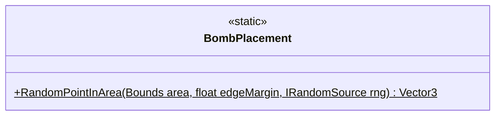

# BombPlacement

> Pure placement helper for bomb spawns.

**Módulo:** [[Modulo Items|Items]] · **Namespace:** `AlienFarms.Items` · **Archivo:** `Assets/Scripts/Items/BombPlacement.cs`

## Diagrama

## Usa
[[IRandomSource]]

## Usado por
[[BombSpawner]]
