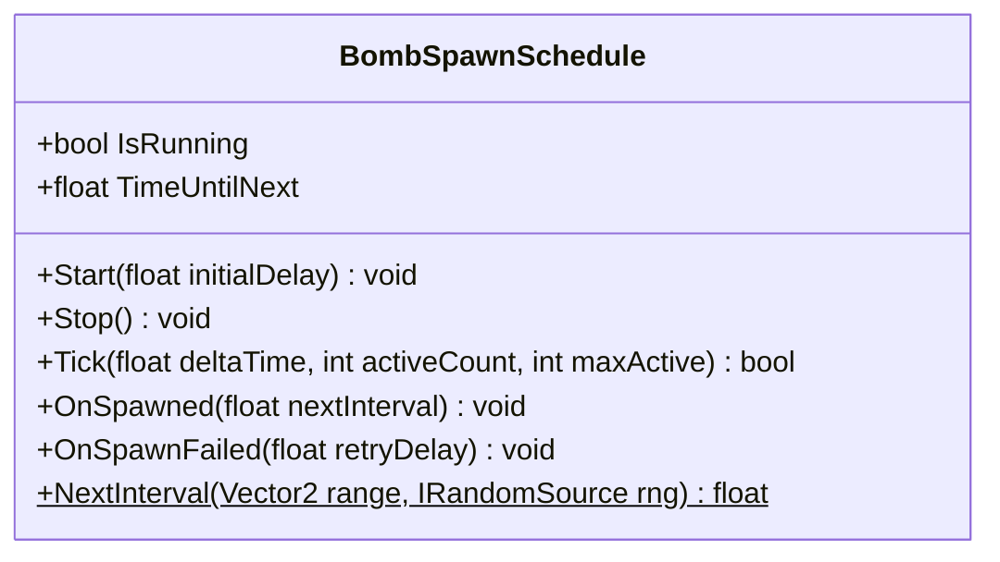

# BombSpawnSchedule

> Pure spawn timer for bombs. Counts down only while running and while there is a free slot (the timer pauses while the max number of bombs is in play). Once due, it stays due until the caller reports the outcome with `OnSpawned` or `OnSpawnFailed`.

**Módulo:** [[Modulo Items|Items]] · **Namespace:** `AlienFarms.Items` · **Archivo:** `Assets/Scripts/Items/BombSpawnSchedule.cs`

## Diagrama

## Usa
[[IRandomSource]]

## Usado por
[[BombSpawner]]
