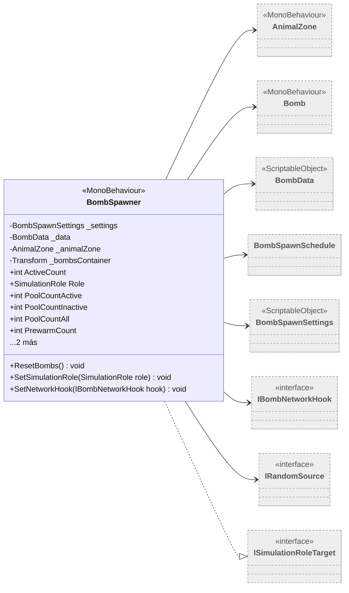

# BombSpawner

> Scene composition root for stun bombs: owns the bomb pool and drops bombs at random free spots of the Animal Zone while a round is playing (timer paused while the max is in play). Bombs never exist outside Playing. As a `SimulationRole.Replica` it only keeps the pool (for replicated bombs) and never spawns or clears.

**Módulo:** [[Modulo Items|Items]] · **Namespace:** `AlienFarms.Items` · **Archivo:** `Assets/Scripts/Items/BombSpawner.cs`

## Hereda / implementa
`MonoBehaviour`, [[ISimulationRoleTarget]]

## Diagrama

## Usa
[[Animal]], [[AnimalZone]], [[Bomb]], [[BombData]], [[BombPlacement]], [[BombSpawnSchedule]], [[BombSpawnSettings]], [[BombState]], [[GameEvents]], [[IBombNetworkHook]], [[IRandomSource]], [[ISimulationRoleTarget]], [[LayerNames]], [[MatchPhase]], [[SimulationRole]], [[SystemRandomSource]]

## Usado por
[[MatchManager]], [[NetworkBombPoolHandler]], [[NetworkSpawnRegistry]], [[OnlineMatchBootstrap]]

## Eventos que escucha
[[Eventos GameEvents#OnMatchPhaseChanged|OnMatchPhaseChanged]]
