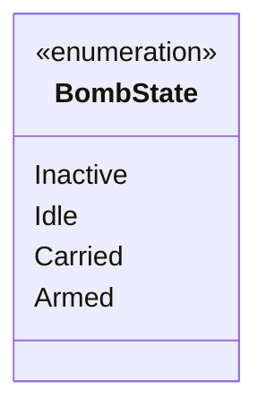

# BombState

> Lifecycle of a pooled `Bomb`.

**Módulo:** [[Modulo Items|Items]] · **Namespace:** `AlienFarms.Items` · **Archivo:** `Assets/Scripts/Items/BombState.cs`

## Diagrama

## Valores
`Inactive`, `Idle`, `Carried`, `Armed`

## Usado por
[[Bomb]], [[BombBlastRules]], [[BombNetState]], [[BombSpawner]], [[NetworkBomb]]
