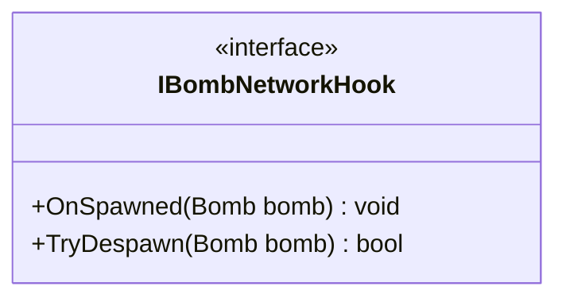

# IBombNetworkHook

> Lets a network layer follow the authority's bomb lifecycle. Without a hook, bombs go straight back to their pool on despawn (local mode).

**Módulo:** [[Modulo Items|Items]] · **Namespace:** `AlienFarms.Items` · **Archivo:** `Assets/Scripts/Items/IBombNetworkHook.cs`

## Diagrama

## Usa
[[Bomb]]

## Usado por
[[Bomb]], [[BombSpawner]]
