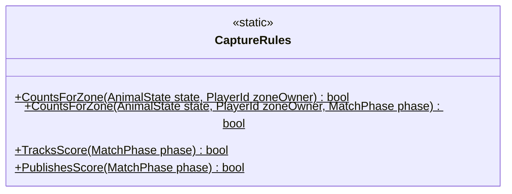

# CaptureRules

> Pure scoring rules. The score is zone occupancy: an animal counts for a zone's owner while it is captured there, whoever released it. Carried and airborne animals never count. The round's bookkeeping (score and pen contents) only changes while playing: from the moment the phase leaves Playing it is frozen, so the published result, the replicated score board and the match's own score are the same final value.

**Módulo:** [[Modulo Match|Match]] · **Namespace:** `AlienFarms.Match` · **Archivo:** `Assets/Scripts/Match/CaptureRules.cs`

## Diagrama

## Usa
[[AnimalState]], [[MatchPhase]], [[PlayerId]]

## Usado por
[[MatchManager]], [[MatchScore]]
