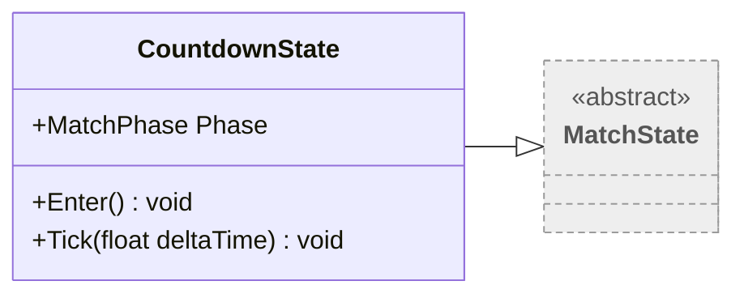

# CountdownState

> Resets the round, freezes players and counts down before play starts.

**Módulo:** [[Modulo Match|Match]] · **Namespace:** `AlienFarms.Match` · **Archivo:** `Assets/Scripts/Match/CountdownState.cs`

## Hereda / implementa
[[MatchState]]

## Diagrama

## Usa
[[GameEvents]], [[IMatchContext]], [[MatchPhase]], [[MatchState]], [[Phase]]

## Usado por
[[MatchStateMachine]]

## Eventos que publica
[[Eventos GameEvents#OnCountdownFinished|OnCountdownFinished]], [[Eventos GameEvents#OnCountdownTick|OnCountdownTick]]
