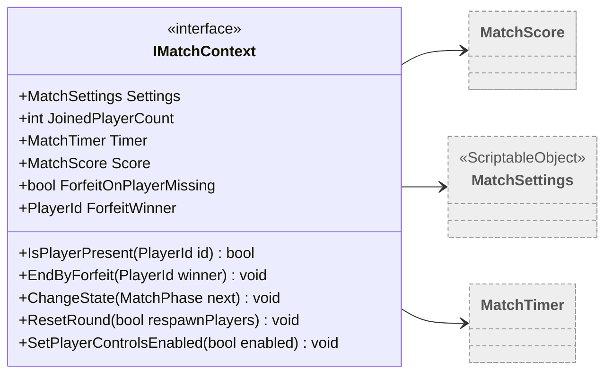

# IMatchContext

> What match states may read and do. Implemented by MatchManager (and by test fakes).

**Módulo:** [[Modulo Match|Match]] · **Namespace:** `AlienFarms.Match` · **Archivo:** `Assets/Scripts/Match/IMatchContext.cs`

## Derivados / implementaciones
[[MatchManager]]

## Diagrama

## Usa
[[MatchPhase]], [[MatchScore]], [[MatchSettings]], [[MatchTimer]], [[PlayerId]]

## Usado por
[[CountdownState]], [[MatchManager]], [[MatchState]], [[MatchStateMachine]], [[PlayingState]], [[ResultsState]], [[WaitingForPlayersState]]
