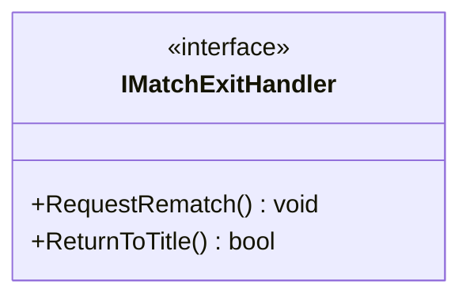

# IMatchExitHandler

> What the match exit buttons do. Local: `LocalMatchExitHandler`; online, a network handler.

**Módulo:** [[Modulo Match|Match]] · **Namespace:** `AlienFarms.Match` · **Archivo:** `Assets/Scripts/Match/IMatchExitHandler.cs`

## Derivados / implementaciones
[[LocalMatchExitHandler]]

## Diagrama

## Usado por
[[LocalMatchExitHandler]], [[MatchExit]]
