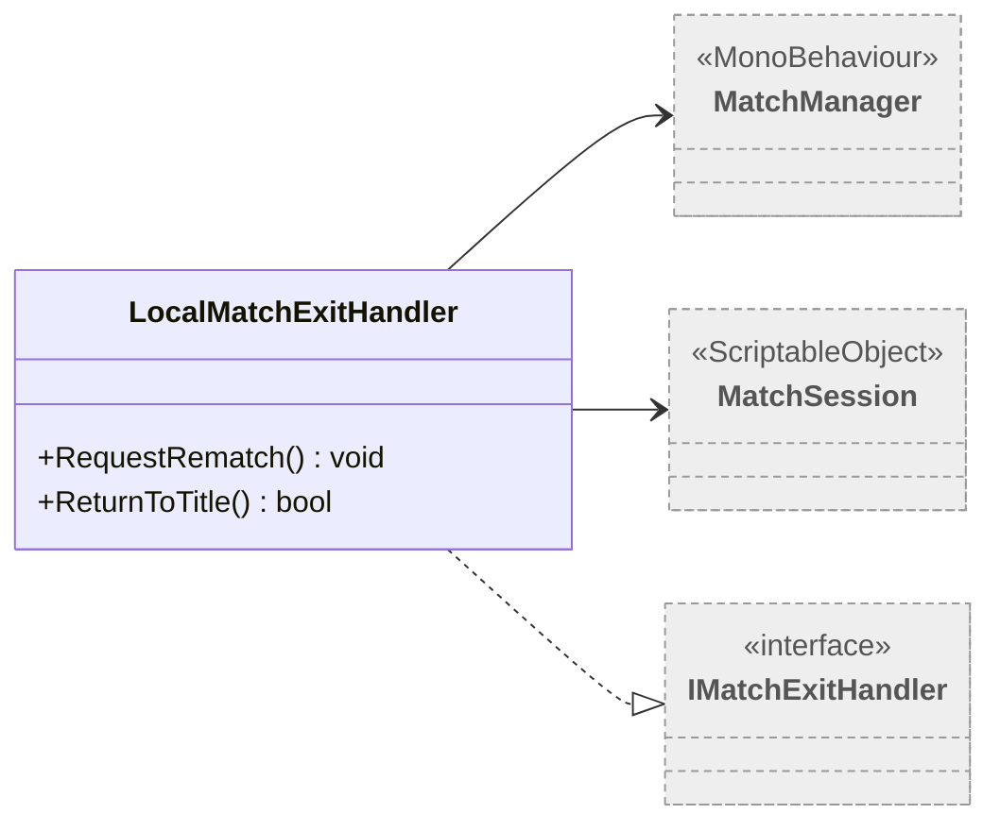

# LocalMatchExitHandler

> Local split-screen exit: rematch through the `MatchManager`; returning to the title clears the `MatchSession` and loads the main menu (time and audio are restored by `SceneFlow`).

**Módulo:** [[Modulo Match|Match]] · **Namespace:** `AlienFarms.Match` · **Archivo:** `Assets/Scripts/Match/LocalMatchExitHandler.cs`

## Hereda / implementa
[[IMatchExitHandler]]

## Diagrama

## Usa
[[IMatchExitHandler]], [[MatchManager]], [[MatchSession]], [[SceneFlow]]

## Usado por
[[MatchExit]]
