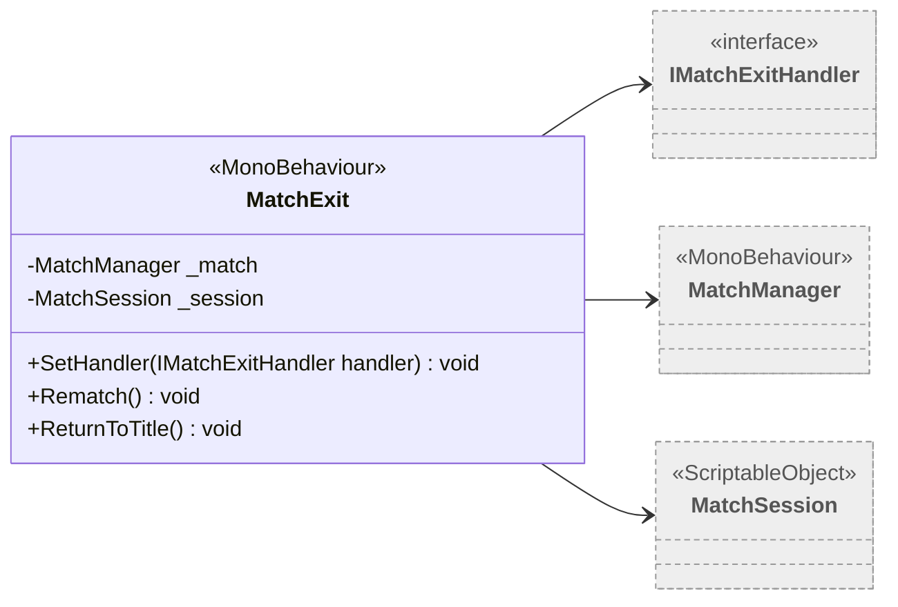

# MatchExit

> Exit options of a finished (or paused) match, wired to menu buttons: rematch or back to the title screen. What they do is delegated to an `IMatchExitHandler`: the local one by default, or one set with `SetHandler`.

**Módulo:** [[Modulo Match|Match]] · **Namespace:** `AlienFarms.Match` · **Archivo:** `Assets/Scripts/Match/MatchExit.cs`

## Hereda / implementa
`MonoBehaviour`

## Diagrama

## Usa
[[IMatchExitHandler]], [[LocalMatchExitHandler]], [[MatchManager]], [[MatchSession]]

## Usado por
[[PauseController]]
