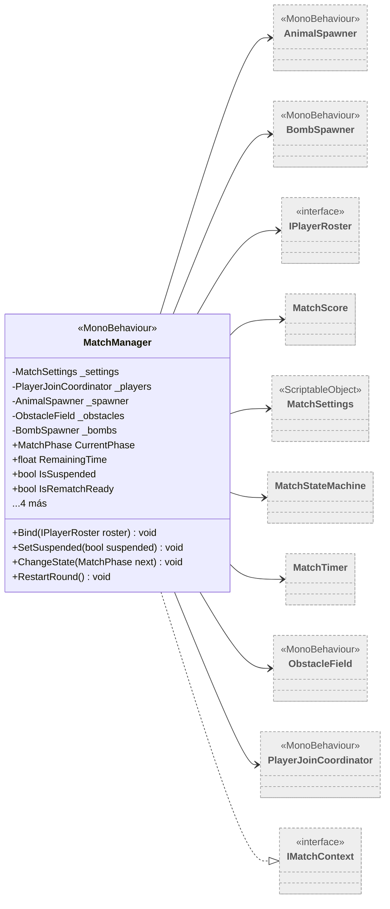

# MatchManager

> Scene composition root of the match: owns the phase state machine, score and timer, and bridges them to the players (via `PlayerJoinCoordinator`) and the animals (via `AnimalSpawner`). The score (sum of each captured animal's points) mirrors zone occupancy from `GameEvents.OnAnimalCaptured` / `GameEvents.OnAnimalLeftZone`; it is tracked in every phase but only published while playing. The players come from an `IPlayerRoster`: the serialized coordinator unless another one is bound with `Bind` before Start.

**Módulo:** [[Modulo Match|Match]] · **Namespace:** `AlienFarms.Match` · **Archivo:** `Assets/Scripts/Match/MatchManager.cs`

## Hereda / implementa
`MonoBehaviour`, [[IMatchContext]]

## Diagrama

## Usa
[[Animal]], [[AnimalData]], [[AnimalSpawner]], [[BombSpawner]], [[CaptureRules]], [[GameEvents]], [[IMatchContext]], [[IPlayerRoster]], [[MatchPhase]], [[MatchScore]], [[MatchSettings]], [[MatchStateMachine]], [[MatchTimer]], [[ObstacleField]], [[PlayerId]], [[PlayerJoinCoordinator]]

## Usado por
[[GameModeRouter]], [[LocalMatchExitHandler]], [[MatchExit]], [[OnlineMatchBootstrap]], [[OnlineMatchExitHandler]], [[PauseController]], [[ResultsMenuController]]

## Eventos que publica
[[Eventos GameEvents#OnMatchTimeChanged|OnMatchTimeChanged]], [[Eventos GameEvents#OnPenInventoryChanged|OnPenInventoryChanged]], [[Eventos GameEvents#OnScoreChanged|OnScoreChanged]]

## Eventos que escucha
[[Eventos GameEvents#OnAnimalCaptured|OnAnimalCaptured]], [[Eventos GameEvents#OnAnimalLeftZone|OnAnimalLeftZone]]
