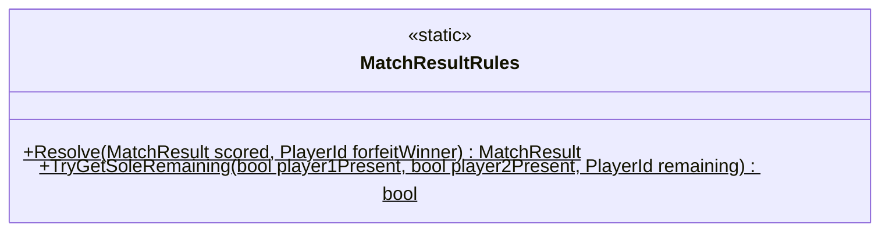

# MatchResultRules

> How the published `MatchResult` is built from the scored one. Shared by the match (server / local) and the online replica, so both raise the same result.

**Módulo:** [[Modulo Match|Match]] · **Namespace:** `AlienFarms.Match` · **Archivo:** `Assets/Scripts/Match/MatchResultRules.cs`

## Diagrama

## Usa
[[MatchEndReason]], [[MatchResult]], [[PlayerId]]

## Usado por
[[NetworkMatchState]], [[PlayingState]], [[ResultsState]]
