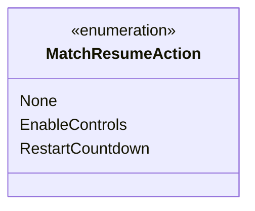

# MatchResumeAction

> What the match does when a suspension ends (see `MatchSuspendRules.OnResume`).

**Módulo:** [[Modulo Match|Match]] · **Namespace:** `AlienFarms.Match` · **Archivo:** `Assets/Scripts/Match/MatchResumeAction.cs`

## Diagrama

## Valores
`None`, `EnableControls`, `RestartCountdown`

## Usado por
[[MatchManager]], [[MatchSuspendRules]]
