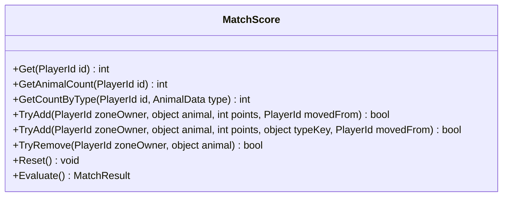

# MatchScore

> Zone occupancy for the current round: the animals each player's zone holds, the points each one is worth and its type. A player's score is the sum of the points in its zone. Idempotent (duplicate events are absorbed) and an animal is in at most one zone; the points recorded on entry are the ones removed on exit. Pure logic: animals and types are opaque keys.

**Módulo:** [[Modulo Match|Match]] · **Namespace:** `AlienFarms.Match` · **Archivo:** `Assets/Scripts/Match/MatchScore.cs`

## Diagrama

## Usa
[[AnimalData]], [[MatchResult]], [[PlayerId]]

## Usado por
[[IMatchContext]], [[MatchManager]]
