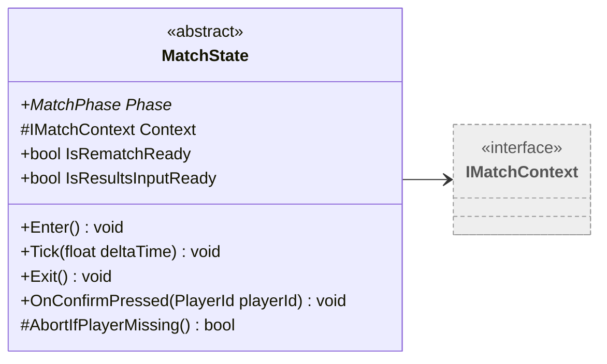

# MatchState

> Base of the match State pattern. Plain C# (testable in EditMode). Rule: no state calls `IMatchContext.ChangeState` from `Enter`; transitions happen only in `Tick` or `OnConfirmPressed`, so the phase event always precedes the next Enter.

**Módulo:** [[Modulo Match|Match]] · **Namespace:** `AlienFarms.Match` · **Archivo:** `Assets/Scripts/Match/MatchState.cs`

## Derivados / implementaciones
[[CountdownState]], [[PlayingState]], [[ResultsState]], [[WaitingForPlayersState]]

## Diagrama

## Usa
[[IMatchContext]], [[MatchPhase]], [[Phase]], [[PlayerId]]

## Usado por
[[CountdownState]], [[MatchStateMachine]], [[PlayingState]], [[ResultsState]], [[WaitingForPlayersState]]
