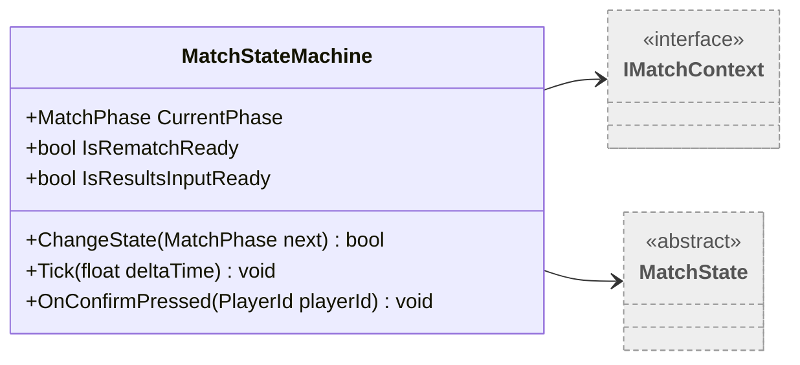

# MatchStateMachine

> Plain C# match state machine: owns one state per `MatchPhase` and performs transitions. Side effects (players, animals, score, timer) live in the `IMatchContext`.

**Módulo:** [[Modulo Match|Match]] · **Namespace:** `AlienFarms.Match` · **Archivo:** `Assets/Scripts/Match/MatchStateMachine.cs`

## Diagrama

## Usa
[[CountdownState]], [[GameEvents]], [[IMatchContext]], [[MatchPhase]], [[MatchState]], [[Phase]], [[PlayerId]], [[PlayingState]], [[ResultsState]], [[WaitingForPlayersState]]

## Usado por
[[MatchManager]]

## Eventos que publica
[[Eventos GameEvents#OnMatchPhaseChanged|OnMatchPhaseChanged]]
