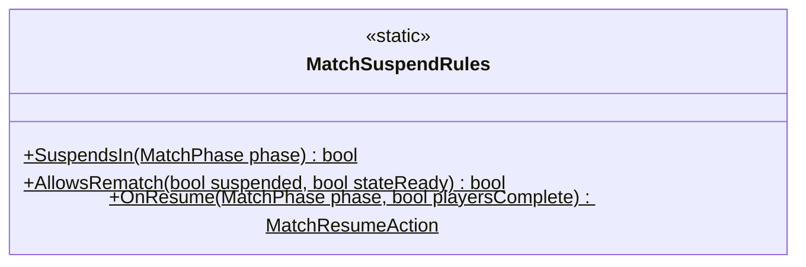

# MatchSuspendRules

> Pure rules of a match suspension (online reconnection grace): which phases are suspended and what to do when the suspension ends.

**Módulo:** [[Modulo Match|Match]] · **Namespace:** `AlienFarms.Match` · **Archivo:** `Assets/Scripts/Match/MatchSuspendRules.cs`

## Diagrama

## Usa
[[MatchPhase]], [[MatchResumeAction]]

## Usado por
[[MatchConnectionCueTracker]], [[MatchManager]], [[ReconnectGraceCoordinator]]
