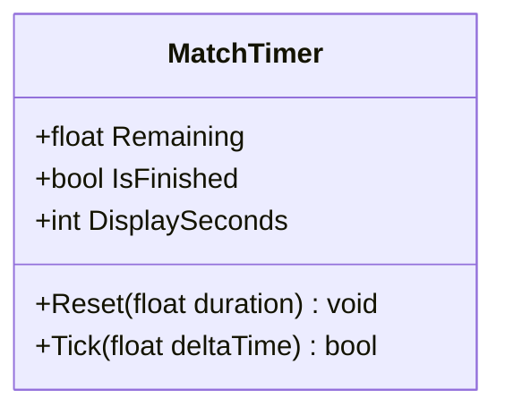

# MatchTimer

> Countdown of the round time. Driven externally with `Tick` (no Time.* access).

**Módulo:** [[Modulo Match|Match]] · **Namespace:** `AlienFarms.Match` · **Archivo:** `Assets/Scripts/Match/MatchTimer.cs`

## Diagrama

## Usado por
[[IMatchContext]], [[MatchManager]], [[PlayingState]]
