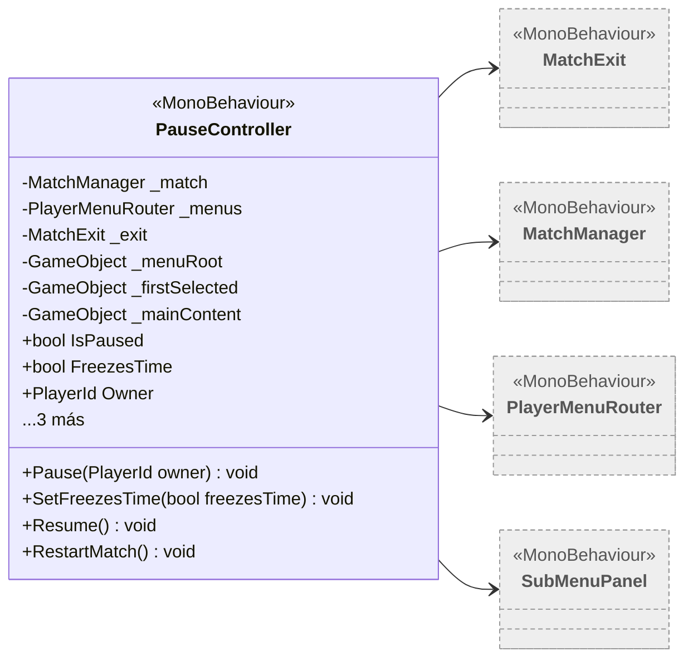

# PauseController

> Game pause: freezes time (`Time.timeScale` = 0) and audio, and routes the pause menu to the player who requested it; the other player is blocked. Only the pausing player navigates. Methods are wired to menu buttons.

**Módulo:** [[Modulo Match|Match]] · **Namespace:** `AlienFarms.Match` · **Archivo:** `Assets/Scripts/Match/PauseController.cs`

## Hereda / implementa
`MonoBehaviour`

## Diagrama

## Usa
[[GameEvents]], [[MatchExit]], [[MatchManager]], [[PauseRules]], [[PlayerId]], [[PlayerMenuRouter]], [[SubMenuPanel]]

## Usado por
[[GameModeRouter]]

## Eventos que publica
[[Eventos GameEvents#OnGamePaused|OnGamePaused]], [[Eventos GameEvents#OnGameResumed|OnGameResumed]]

## Eventos que escucha
[[Eventos GameEvents#OnMenuCancelPressed|OnMenuCancelPressed]], [[Eventos GameEvents#OnPauseRequested|OnPauseRequested]], [[Eventos GameEvents#OnPlayerDeviceLost|OnPlayerDeviceLost]], [[Eventos GameEvents#OnPlayerDeviceRegained|OnPlayerDeviceRegained]], [[Eventos GameEvents#OnPlayerLeft|OnPlayerLeft]]
