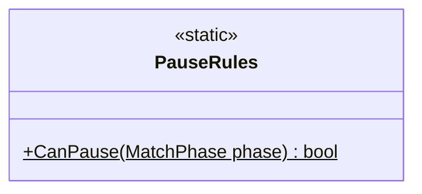

# PauseRules

> Pure rules for when the game may be paused.

**Módulo:** [[Modulo Match|Match]] · **Namespace:** `AlienFarms.Match` · **Archivo:** `Assets/Scripts/Match/PauseRules.cs`

## Diagrama

## Usa
[[MatchPhase]]

## Usado por
[[PauseController]], [[PauseHoldIndicatorView]]
