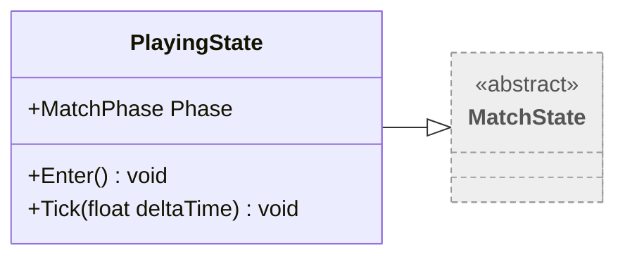

# PlayingState

> Round in progress: timer runs (1 Hz event) and score changes are published.

**Módulo:** [[Modulo Match|Match]] · **Namespace:** `AlienFarms.Match` · **Archivo:** `Assets/Scripts/Match/PlayingState.cs`

## Hereda / implementa
[[MatchState]]

## Diagrama

## Usa
[[GameEvents]], [[IMatchContext]], [[MatchPhase]], [[MatchState]], [[MatchTimer]]

## Usado por
[[MatchStateMachine]]

## Eventos que publica
[[Eventos GameEvents#OnMatchTimeChanged|OnMatchTimeChanged]]
