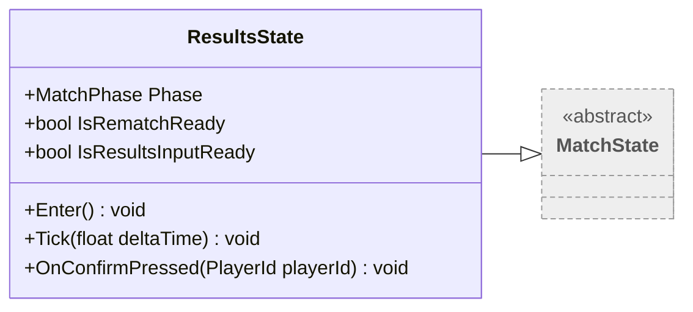

# ResultsState

> Round over: publishes the result, freezes players and restarts on Confirm after a short delay. A forfeit result (the rival left during Playing) stays on screen with one player; the rematch still needs both.

**Módulo:** [[Modulo Match|Match]] · **Namespace:** `AlienFarms.Match` · **Archivo:** `Assets/Scripts/Match/ResultsState.cs`

## Hereda / implementa
[[MatchState]]

## Diagrama

## Usa
[[GameEvents]], [[IMatchContext]], [[MatchPhase]], [[MatchResult]], [[MatchResultRules]], [[MatchState]], [[Phase]], [[PlayerId]]

## Usado por
[[MatchStateMachine]]

## Eventos que publica
[[Eventos GameEvents#OnMatchEnded|OnMatchEnded]]
