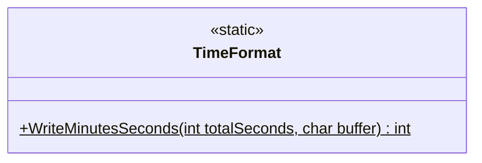

# TimeFormat

> Allocation-free time formatting into reusable char buffers.

**Módulo:** [[Modulo Match|Match]] · **Namespace:** `AlienFarms.Match` · **Archivo:** `Assets/Scripts/Match/TimeFormat.cs`

## Diagrama

## Usado por
[[MatchTimerView]]
