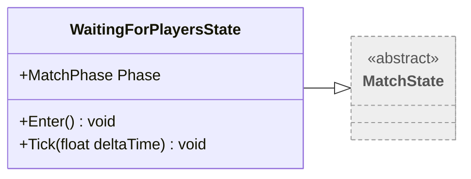

# WaitingForPlayersState

> Free roam until both players have joined; captures are not scored (the countdown resets the round).

**Módulo:** [[Modulo Match|Match]] · **Namespace:** `AlienFarms.Match` · **Archivo:** `Assets/Scripts/Match/WaitingForPlayersState.cs`

## Hereda / implementa
[[MatchState]]

## Diagrama

## Usa
[[IMatchContext]], [[MatchPhase]], [[MatchState]]

## Usado por
[[MatchStateMachine]]
