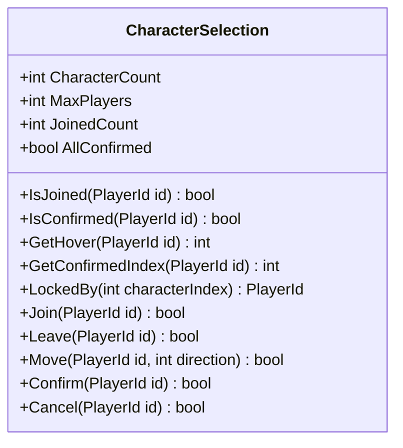

# CharacterSelection

> Plain C# model of the character select screen: which players joined, which character each one hovers and which characters are locked (confirmed). A character can be locked by a single player; locked characters are skipped by the other players' cursors.

**Módulo:** [[Modulo Menu|Menu]] · **Namespace:** `AlienFarms.Menu` · **Archivo:** `Assets/Scripts/Menu/CharacterSelection.cs`

## Diagrama

## Usa
[[PlayerId]]

## Usado por
[[MenuFlowController]]
