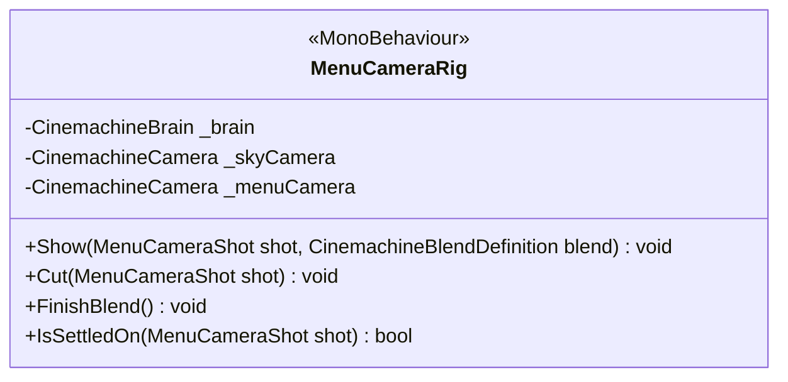

# MenuCameraRig

**Módulo:** [[Modulo Menu|Menu]] · **Namespace:** `AlienFarms.Menu` · **Archivo:** `Assets/Scripts/Menu/MenuCameraRig.cs`

## Hereda / implementa
`MonoBehaviour`

## Diagrama

## Usa
[[MenuCameraShot]]

## Usado por
[[TitleIntroDirector]]
