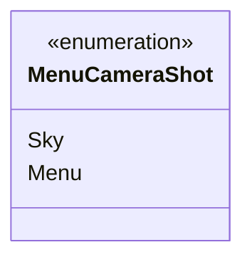

# MenuCameraShot

**Módulo:** [[Modulo Menu|Menu]] · **Namespace:** `AlienFarms.Menu` · **Archivo:** `Assets/Scripts/Menu/MenuCameraShot.cs`

## Diagrama

## Valores
`Sky`, `Menu`

## Usado por
[[MenuCameraRig]], [[TitleIntroDirector]], [[TitleIntroModel]]
