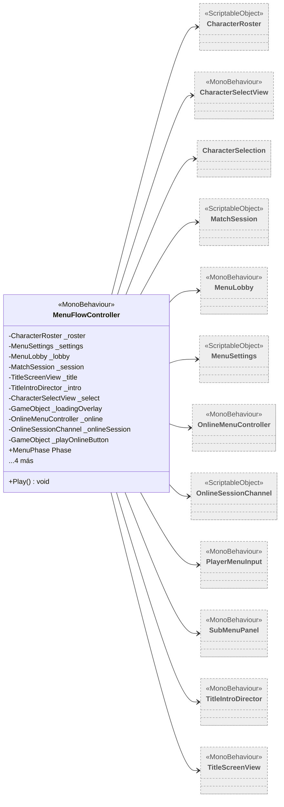

# MenuFlowController

> MainMenu composition root: Title or SubMenu -> CharacterSelect -> Loading. On the title the first joined player owns the buttons (the other is blocked); on character select every player moves its own cursor, confirms (locks) and cancels. When both have confirmed, their devices, scheme and character go to the `MatchSession` and the gameplay scene is loaded. Input state changes are always applied outside input callbacks (next frame on join, or from PlayerMenuInput's Update dispatch). Title sub-menus (`SubMenuPanel`) are navigated by the title owner; Cancel or the panel's Back button returns to the title. Online play hands the title owner to the `OnlineMenuController` (Online phase); there the match scene is loaded by the network, never here.

**Módulo:** [[Modulo Menu|Menu]] · **Namespace:** `AlienFarms.Menu` · **Archivo:** `Assets/Scripts/Menu/MenuFlowController.cs`

## Hereda / implementa
`MonoBehaviour`

## Diagrama

## Usa
[[CharacterDefinition]], [[CharacterRoster]], [[CharacterSelectView]], [[CharacterSelection]], [[GameEvents]], [[MatchSession]], [[MenuLobby]], [[MenuPhase]], [[MenuSettings]], [[OnlineMenuController]], [[OnlineMenuRules]], [[OnlineSessionChannel]], [[OnlineSessionStatus]], [[Phase]], [[PlayerId]], [[PlayerMenuInput]], [[PlayerSlotState]], [[SceneFlow]], [[SessionSlot]], [[Status]], [[SubMenuPanel]], [[TitleIntroDirector]], [[TitleScreenView]]

## Eventos que publica
[[Eventos GameEvents#OnCharacterPickConfirmed|OnCharacterPickConfirmed]], [[Eventos GameEvents#OnCharacterPickReleased|OnCharacterPickReleased]]
