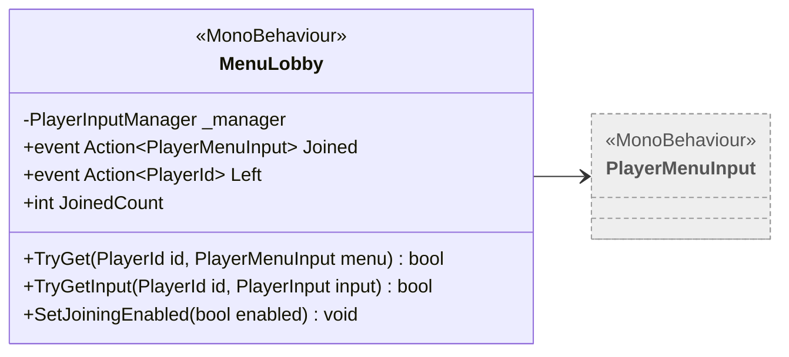

# MenuLobby

> MainMenu player registry: listens to `PlayerInputManager` (MenuPlayer prefab), assigns each joined player its `PlayerId` from the player index and keeps its `PlayerMenuInput` and `PlayerInput` (devices and control scheme for the match session).

**Módulo:** [[Modulo Menu|Menu]] · **Namespace:** `AlienFarms.Menu` · **Archivo:** `Assets/Scripts/Menu/MenuLobby.cs`

## Hereda / implementa
`MonoBehaviour`

## Diagrama

## Usa
[[PlayerId]], [[PlayerIdentity]], [[PlayerMenuInput]]

## Usado por
[[MenuFlowController]]
