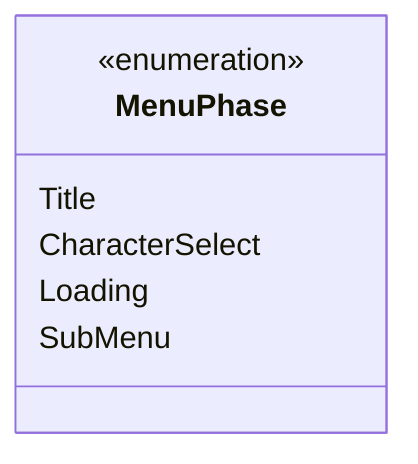

# MenuPhase

> Screens of the MainMenu scene, in flow order.

**Módulo:** [[Modulo Menu|Menu]] · **Namespace:** `AlienFarms.Menu` · **Archivo:** `Assets/Scripts/Menu/MenuPhase.cs`

## Diagrama

## Valores
`Title`, `CharacterSelect`, `Loading`, `SubMenu`

## Usado por
[[MenuFlowController]]
