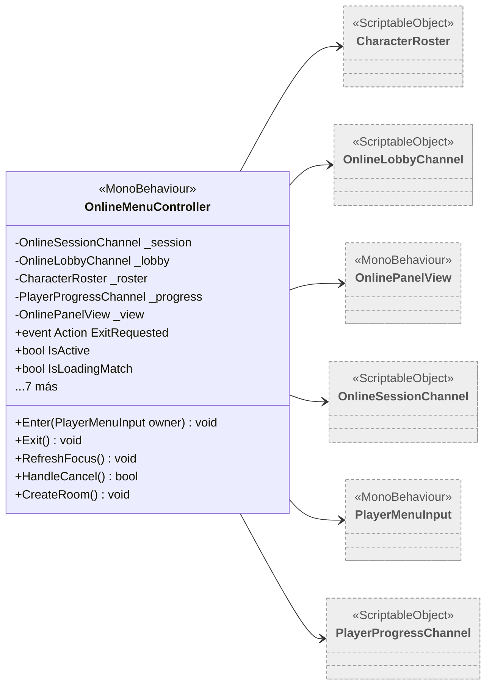

# OnlineMenuController

> Online phase of the MainMenu (hub, join, room) for the title owner. Talks to the network only through the `OnlineSessionChannel` and `OnlineLobbyChannel`: buttons call their Request* methods and every channel change only marks the panel dirty. The panel is rebuilt from the channels in the next frame's Update (never inside a button click), so the owner's input scope changes outside the event system and nothing is redrawn per frame. A full rebuild also covers a MainMenu reloaded while in a session (R1).

**Módulo:** [[Modulo Menu|Menu]] · **Namespace:** `AlienFarms.Menu` · **Archivo:** `Assets/Scripts/Menu/OnlineMenuController.cs`

## Hereda / implementa
`MonoBehaviour`

## Diagrama

## Usa
[[CharacterDefinition]], [[CharacterRoster]], [[DisplayNameSanitizer]], [[LocalizationKeys]], [[OnlineLobbyChannel]], [[OnlineLobbyPhase]], [[OnlineLobbySeat]], [[OnlineMenuRules]], [[OnlinePanelView]], [[OnlineParticipant]], [[OnlineScreen]], [[OnlineSessionChannel]], [[OnlineSessionErrorKeys]], [[OnlineSessionStatus]], [[OnlineSessionStatusRules]], [[Phase]], [[PlayerId]], [[PlayerMenuInput]], [[PlayerProgressChannel]], [[Status]]

## Usado por
[[MenuFlowController]]
