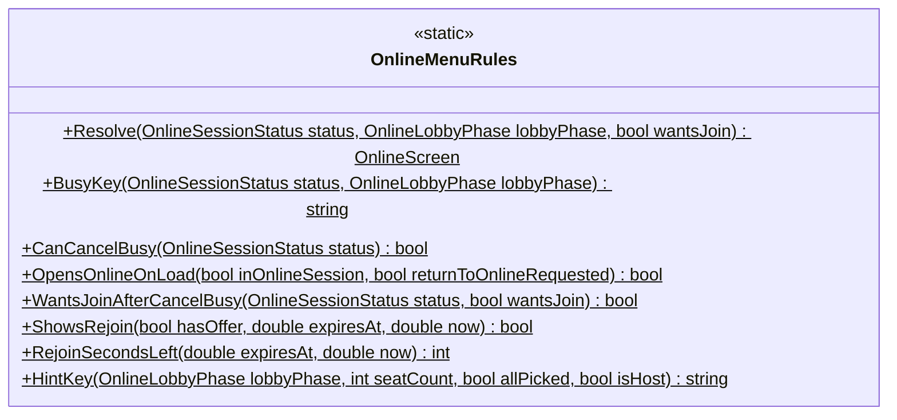

# OnlineMenuRules

> Pure rules of the online menu: which screen the session and lobby state lead to, and which localization keys the busy label and the room hint show. Shared by `OnlineMenuController` and its tests.

**Módulo:** [[Modulo Menu|Menu]] · **Namespace:** `AlienFarms.Menu` · **Archivo:** `Assets/Scripts/Menu/OnlineMenuRules.cs`

## Diagrama

## Usa
[[LocalizationKeys]], [[OnlineLobbyChannel]], [[OnlineLobbyPhase]], [[OnlineScreen]], [[OnlineSessionStatus]]

## Usado por
[[MenuFlowController]], [[OnlineMenuController]]
