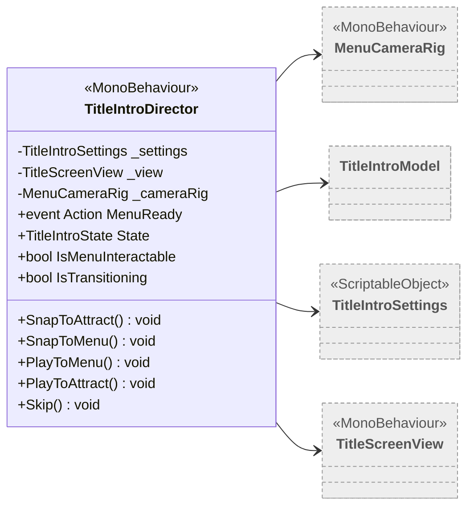

# TitleIntroDirector

**Módulo:** [[Modulo Menu|Menu]] · **Namespace:** `AlienFarms.Menu` · **Archivo:** `Assets/Scripts/Menu/TitleIntroDirector.cs`

## Hereda / implementa
`MonoBehaviour`

## Diagrama

## Usa
[[MenuCameraRig]], [[MenuCameraShot]], [[TitleIntroModel]], [[TitleIntroSettings]], [[TitleIntroState]], [[TitlePromptPulse]], [[TitleScreenView]]

## Usado por
[[MenuFlowController]]
