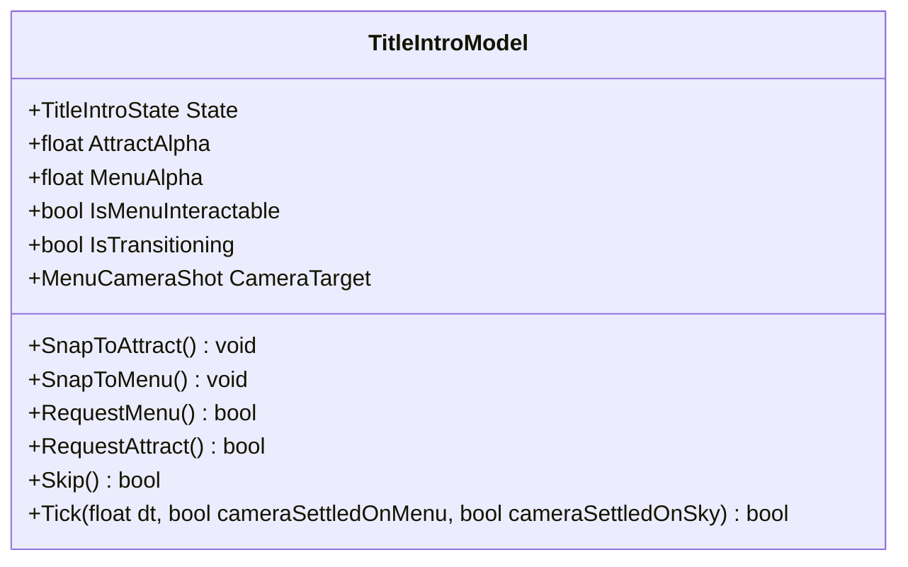

# TitleIntroModel

**Módulo:** [[Modulo Menu|Menu]] · **Namespace:** `AlienFarms.Menu` · **Archivo:** `Assets/Scripts/Menu/TitleIntroModel.cs`

## Diagrama

## Usa
[[MenuCameraShot]], [[TitleIntroState]]

## Usado por
[[TitleIntroDirector]]
